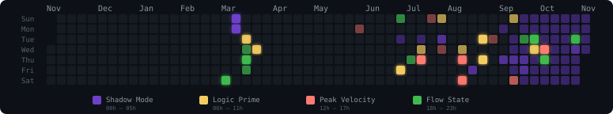

<div align="center">

# Energy Rhythm Graph

**A GitHub contribution graph reimagined by circadian rhythm.**  
Automatically generates a color-coded SVG of your commits, colored by the time of day you code.

[](./LICENSE)

| State | Hours | Color |
|---|---|---|
| **Late Night** | 00h – 05h | Neon Purple |
| **Morning** | 06h – 11h | Soft Gold |
| **Afternoon** | 12h – 17h | Vibrant Orange |
| **Evening** | 18h – 23h | Green |

</div>

---

<div align="center">
   
# Exemple:
Not very colorful, but it's still an example hahahaha.

<p align="center">
  
</p>

</div>

---

## Quick Start (5 minutes)

1.  **Fork** this repository.
2.  Generate a **Personal Access Token (classic)** with `repo` and `read:user` scopes at [github.com/settings/tokens](https://github.com/settings/tokens).
3.  In your fork, go to **Settings → Secrets and variables → Actions** and add a new secret:
    *   **Name:** `GRAPH_TOKEN`
    *   **Value:** (your generated token)
4.  Go to the **Actions** tab, select **Generate Energy Rhythm SVG**, and click **Run workflow**.
5.  Add the generated SVG to your profile README:

```markdown
<p align="center">
  
</p>
```
*Replace `YOUR_USERNAME` with your GitHub handle.*

---

## Configuration (Optional)

The included workflow defaults to **America/Sao_Paulo**. Running the script directly defaults to **UTC**. To use your local time:
1.  Go to **Settings → Secrets and variables → Actions**.
2.  Switch to the **Variables** tab (top right).
3.  Click **New repository variable**.
4.  **Name:** `TIMEZONE` | **Value:** `America/Sao_Paulo` (or [your timezone](https://docs.sentinel.thalesgroup.com/softwareandservices/ems/EMSdocs/WSG/Content/TimeZone.htm)).

---

## How it works

The system uses **Node.js** and the **GitHub GraphQL API** to fetch your commit history from the last 365 days. 

-   **Logic:** Each day is colored based on the *predominant* hour of your commits.
-   **Glow:** High-frequency days (6+ commits) get a subtle neon glow effect.
-   **Precision:** The SVG is locked at **775px** width to perfectly align with other standard GitHub metrics cards.

---

## License

[MIT](./LICENSE) © 2026 hugotakeda

## Counting rules

- Counts commits attributed to your account on accessible owned/collaborator repositories' default branches, excluding forks. This is not GitHub's native contributions calendar, which also includes other activity.
- Paginates repository and commit history queries, deduplicates commit IDs, and uses author dates in the selected timezone.
- Excludes this graph's historical automatic SVG refresh commits by repository, exact message, and bot committer. It does not exclude human code changes in this repository.
- Future SVG updates use `github-actions[bot]` as both author and committer. Historical GitHub contribution credit is unchanged; the exclusion only affects this SVG.

Run regression checks with `node --test tests/generateSvg.test.js`.
